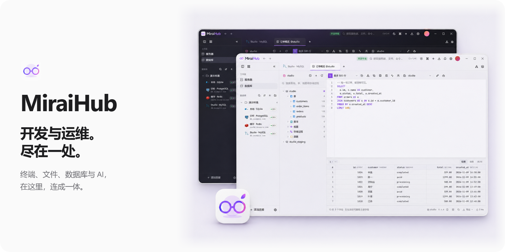
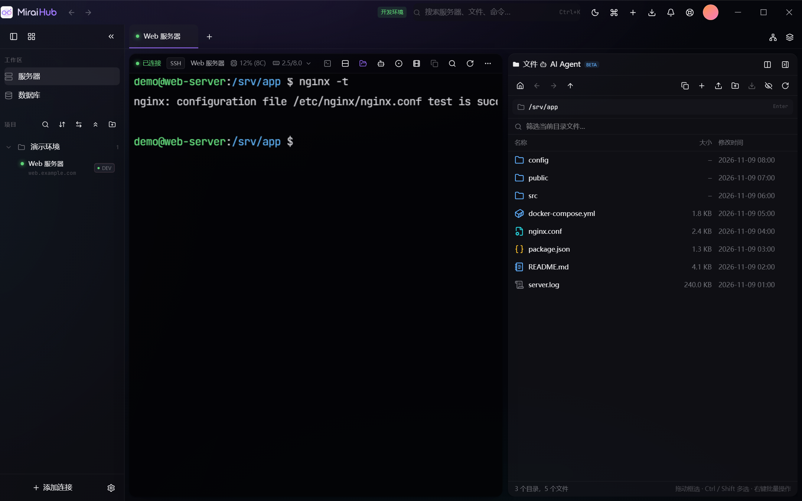
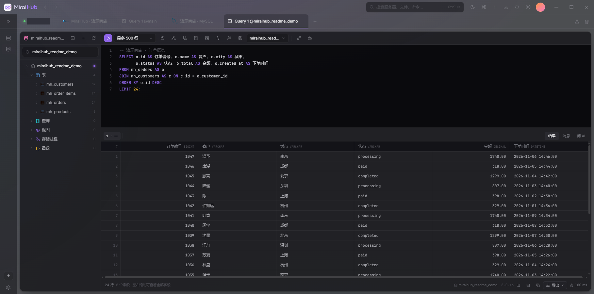
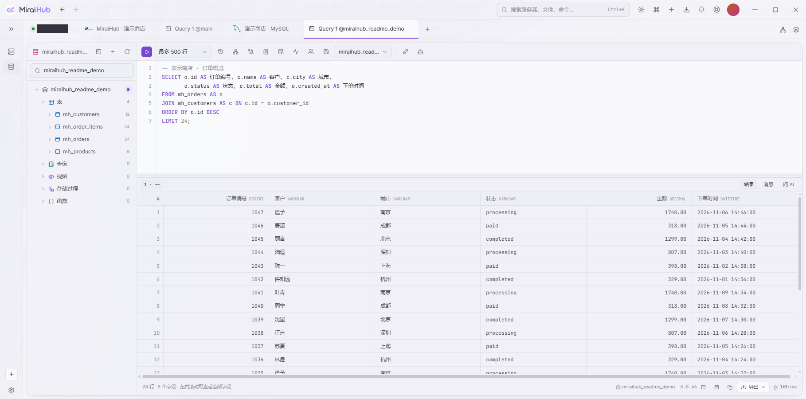
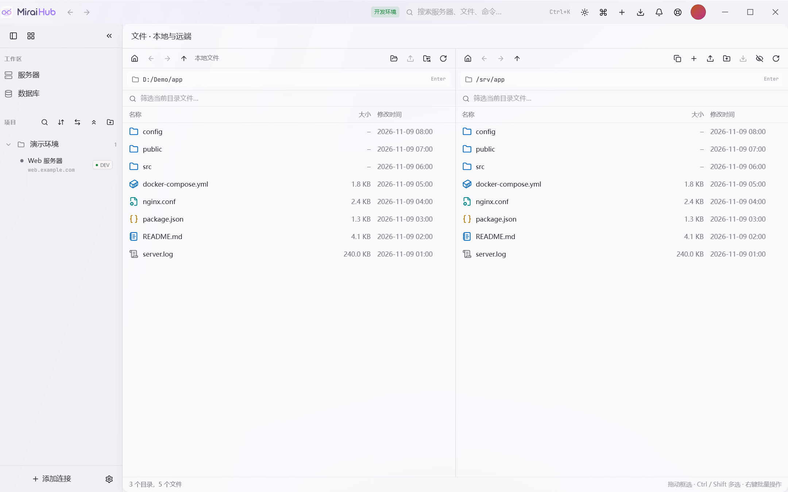
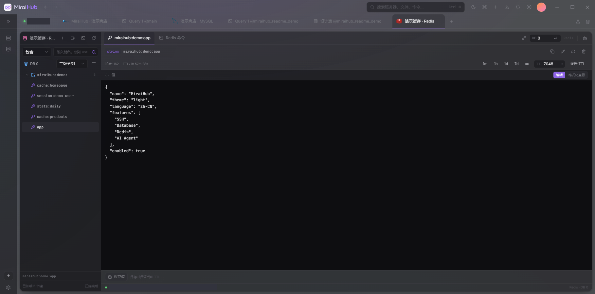
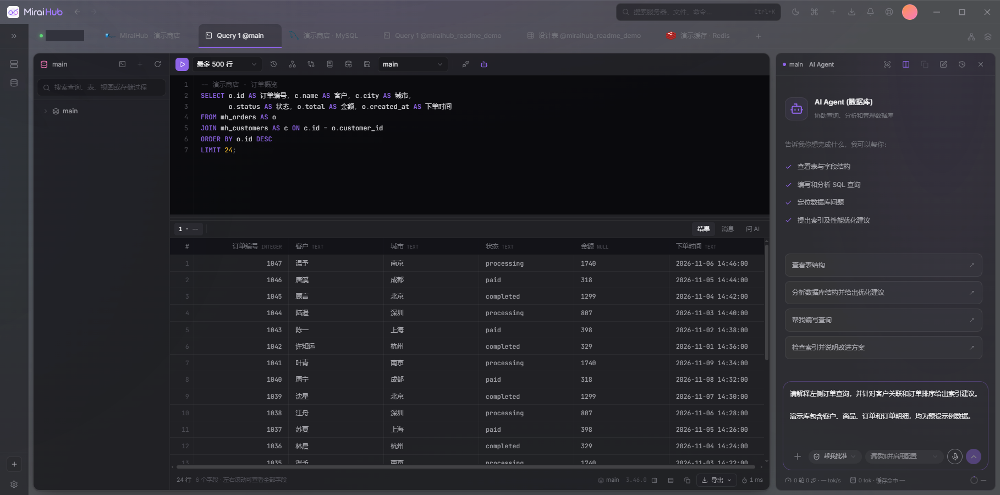
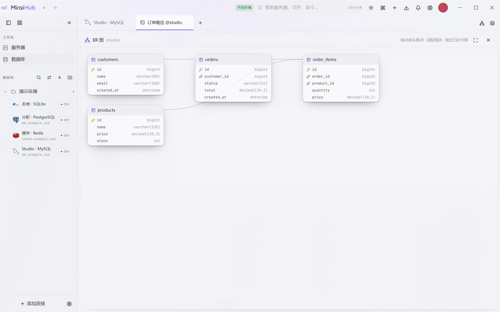
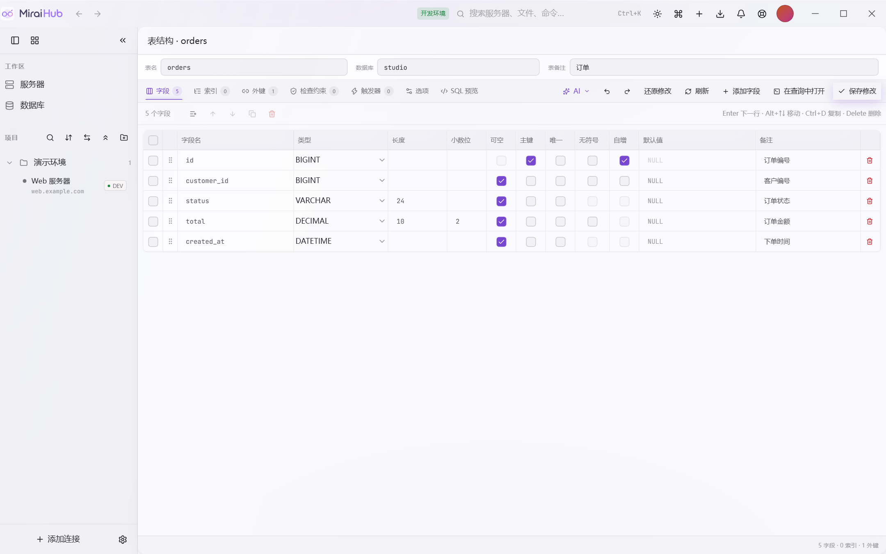
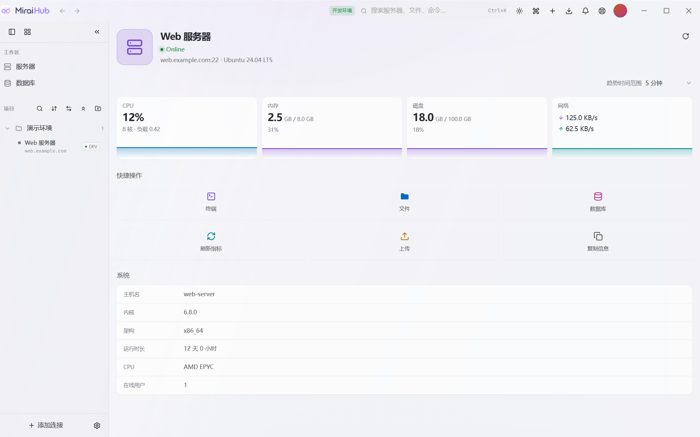

<a href="https://github.com/XiangZi7/MiraiHub/releases/latest"></a>

<p align="center"><a href="https://github.com/XiangZi7/MiraiHub/releases/latest"><strong>下载桌面版 →</strong></a>　·　<a href="#快速开始">快速开始</a>　·　<a href="#文档">文档</a>　·　<a href="https://qm.qq.com/q/QQ_GROUP_INVITE_CODE">QQ群</a>　·　<a href="README.en.md">English</a></p>

<p align="center">
  <a href="https://github.com/XiangZi7/MiraiHub/releases"></a>
  <a href="https://github.com/XiangZi7/MiraiHub/releases"></a>
  <a href="https://github.com/XiangZi7/MiraiHub/actions/workflows/release.yml"></a>
  
  
  
  <a href="LICENSE"></a>
  <a href="https://qm.qq.com/q/QQ_GROUP_INVITE_CODE"></a>
</p>

<p align="center">
  
  
  
  
  
  
  <a href="https://hub.xerj.org/contributors/XiangZi7"></a>
</p>

<p align="center">
  <a href="docs/ssh-operations.md"></a>
  <a href="docs/ssh-operations.md"></a>
  <a href="#快速开始"></a>
  <a href="docs/ssh-operations.md"></a>
  <a href="docs/ai-agent.md"></a>
</p>

<p align="center">
  <a href="docs/database.md"></a>
  <a href="docs/database.md"></a>
  <a href="docs/database.md"></a>
  <a href="docs/database.md"></a>
  <a href="docs/database.md"></a>
  <a href="docs/redis.md"></a>
</p>

<br />

## 界面预览

### SSH 终端与远端文件

<a href="docs/images/feature-ssh-dark.png"></a>

### 数据库 · 深色

<a href="docs/images/feature-database-dark.png"></a>

### 数据库 · 浅色

<a href="docs/images/feature-database-light.png"></a>

### 本地与远端双栏文件

<a href="docs/images/feature-files-light.png"></a>

### Redis 键值编辑

<a href="docs/images/feature-redis-dark.png"></a>

### AI Agent

<a href="docs/images/feature-ai-dark.png"></a>

### ER 关系图

<a href="docs/images/feature-er-light.png"></a>

### 表结构设计

<a href="docs/images/feature-designer-light.png"></a>

### 服务器监控

<a href="docs/images/feature-monitor-light.png"></a>

<sub>使用 pnpm tauri dev 启动的 v4.0.7 桌面软件实拍，包含深浅色界面与预设演示数据，敏感信息已打码；AI 面板为未配置模型的真实状态。[素材说明](docs/images/README.md)</sub>

<br />

## 下载与安装

自动构建目标为 Windows x64、macOS Intel / Apple Silicon、Linux x64。请到 [最新正式版](https://github.com/XiangZi7/MiraiHub/releases/latest)，按下表选择系统、架构和格式，下载带版本号的附件。

| 架构 | Windows | macOS | Linux / Ubuntu |
| --- | --- | --- | --- |
| x86-64（64 位） | EXE（安装版） · ZIP（免安装版） | DMG（Intel） | DEB · AppImage |
| AArch64（ARM64） | — | DMG（Apple Silicon） | — |

Windows ZIP 需 [WebView2 Runtime](https://developer.microsoft.com/microsoft-edge/webview2/)。macOS 11+ 请先将应用拖入「应用程序」；默认临时签名、未配置 Apple 公证，首次打开可能需要在「隐私与安全性」允许。Linux 面向 Ubuntu 22.04+ / 兼容 WebKitGTK 4.1 的发行版；AppImage 需执行权限。AI 安全存储在 Linux 需要已解锁的 Secret Service。

Windows 安装版、macOS 应用与 Linux AppImage 可在「设置 → 关于」更新；DEB 与 Windows ZIP 手动更新。[SHA256SUMS.txt](https://github.com/XiangZi7/MiraiHub/releases/latest/download/SHA256SUMS.txt) 用于校验，[version.json](https://github.com/XiangZi7/MiraiHub/releases/latest/download/version.json) 记录版本与源码提交。更多说明见 [发布文档](docs/RELEASING.md)。

## 快速开始

1. 按上方下载表选择系统与架构，下载安装包。
2. 添加 SSH、本地终端或数据库连接，进入工作区。
3. 需要 AI 时，在「设置 → AI Agent」填入自己的模型服务与 API Key。

免安装版需 [WebView2 Runtime](https://developer.microsoft.com/microsoft-edge/webview2/)。已安装用户可在「设置 → 关于」检查更新。

| 常用操作 | 快捷键 |
| --- | --- |
| 命令面板 | `Ctrl+K` |
| 新建本地终端 | `Ctrl+T` |
| 执行 SQL / Redis 命令 | `Ctrl+Enter` |
| SQL AI 生成 / 改写 | SQL 编辑器内 `Ctrl+K` |

## 文档

[数据库](docs/database.md) · [SSH 与文件](docs/ssh-operations.md) · [Redis](docs/redis.md) · [AI Agent](docs/ai-agent.md) · [主题](docs/theme-skins.md) · [语言](docs/languages.md)

<details>
<summary>本地开发</summary>

需要 Node.js 22、pnpm 10、Rust，以及对应系统依赖：Windows C++ Build Tools / WebView2、macOS Xcode Command Line Tools，或 Linux WebKitGTK 4.1 等（见 [发布文档](docs/RELEASING.md)）。

```powershell
pnpm install --frozen-lockfile
pnpm tauri dev
```

`pnpm build` 检查类型并构建前端；`pnpm test` 运行测试。仅运行 `pnpm dev` 可预览前端，原生能力需完整桌面应用。

[前端架构](docs/FRONTEND_ARCHITECTURE.md) · [性能说明](docs/PERFORMANCE.md) · [发版说明](docs/RELEASING.md)

</details>

<details>
<summary>数据与操作</summary>

AI 对话、附件片段和工具结果会发送到你配置的模型服务，操作按所选审批模式执行。连接备份默认不含凭据；详细数据处理与能力边界见 [AI Agent](docs/ai-agent.md)、[SSH 运维](docs/ssh-operations.md) 和 [数据库文档](docs/database.md)。

</details>

<br />

[反馈问题](https://github.com/XiangZi7/MiraiHub/issues) · [参与贡献](https://github.com/XiangZi7/MiraiHub/pulls) · [MIT License](LICENSE)

<sub>Made by <a href="https://github.com/XiangZi7">XiangZi</a></sub>

## 社区交流

<!-- 将两份 README 中所有 https://qm.qq.com/q/QQ_GROUP_INVITE_CODE 替换为 QQ 群 442179941「分享群聊」生成的完整加群链接。 -->

- QQ 群号：**442179941**
- 加群链接：[点击加入 QQ 群（链接待填写）](https://qm.qq.com/q/QQ_GROUP_INVITE_CODE)
- 社区：<a href="https://linux.do/">LINUX DO</a>
