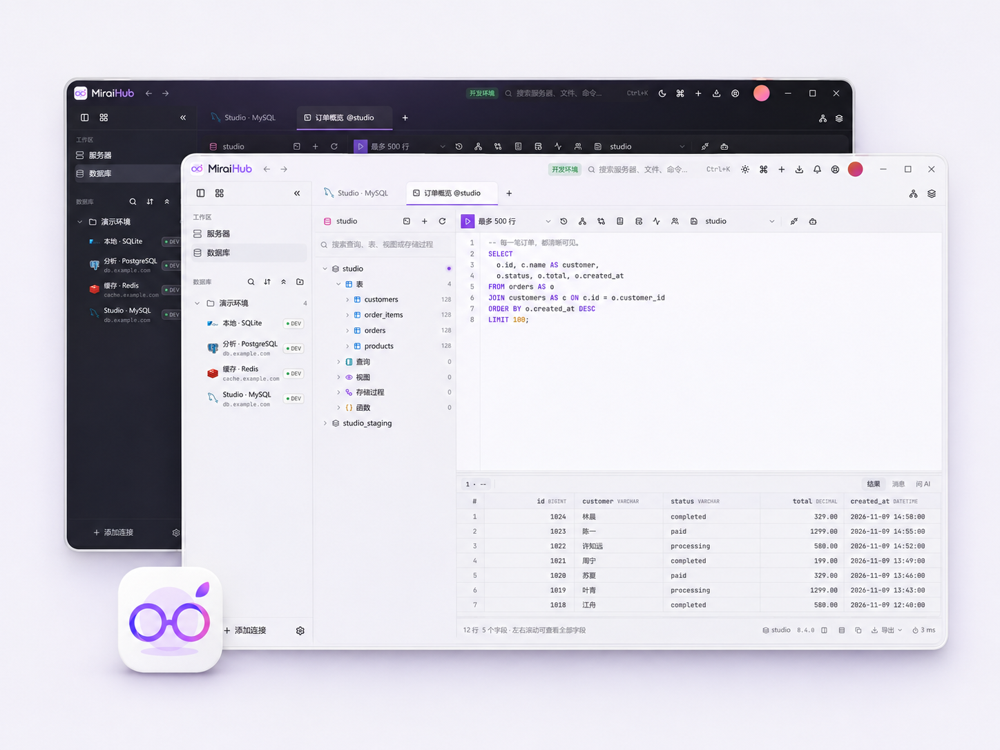
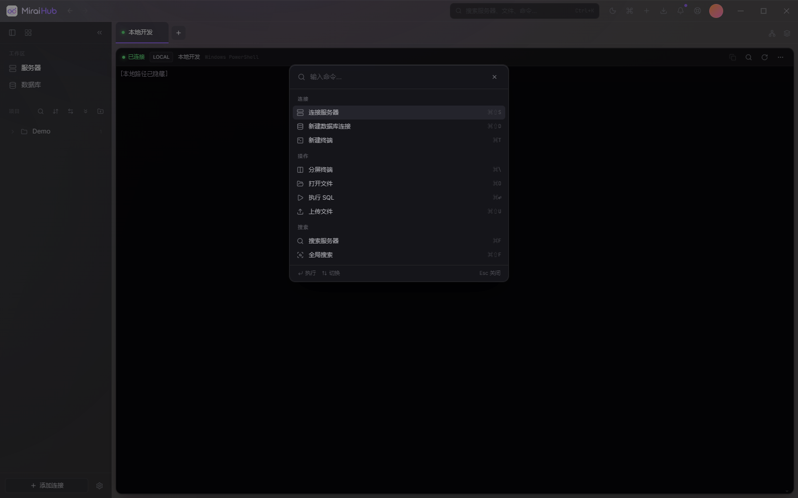
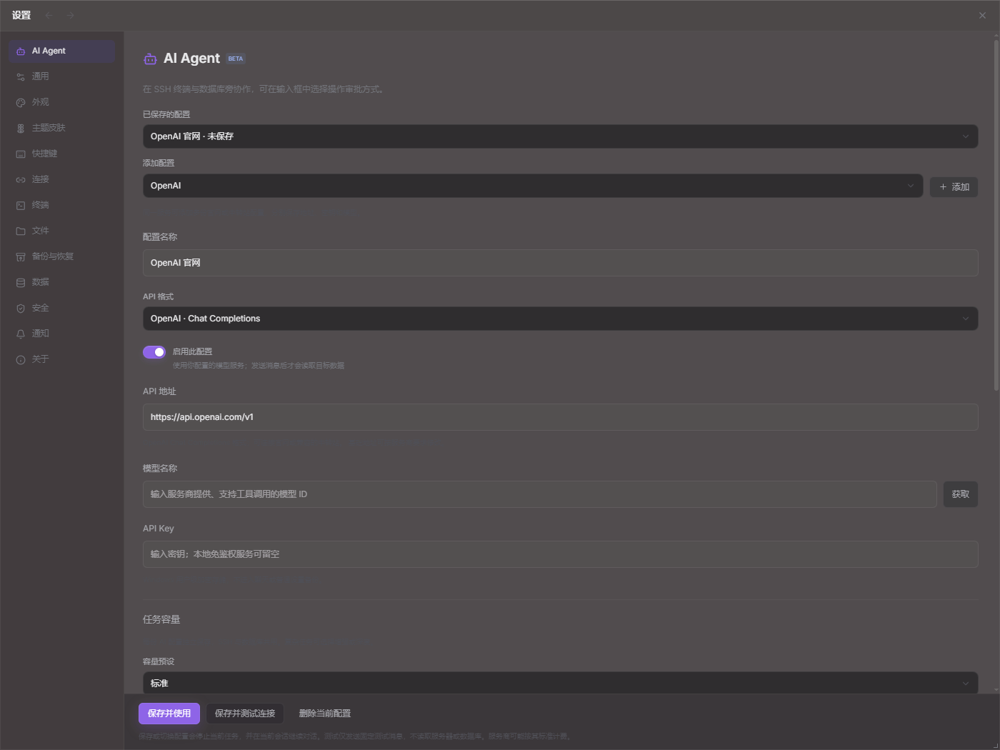
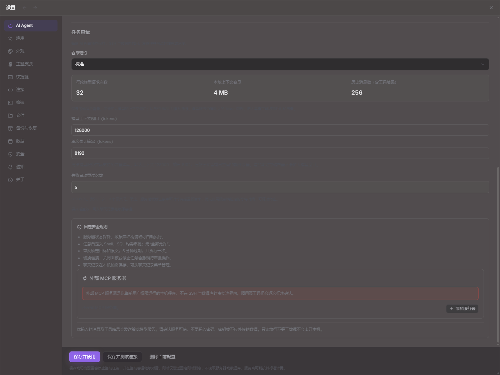
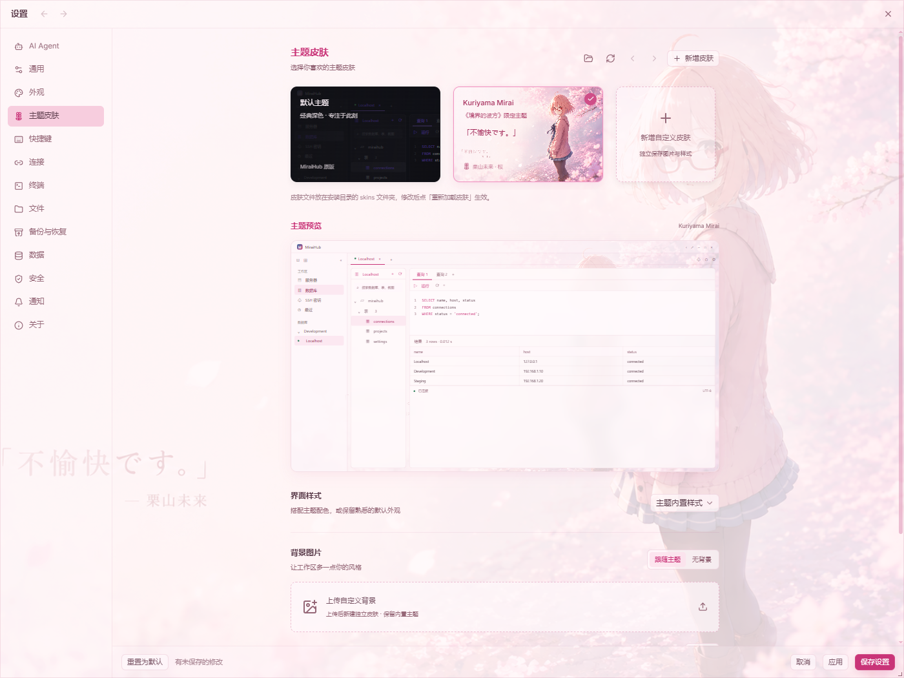
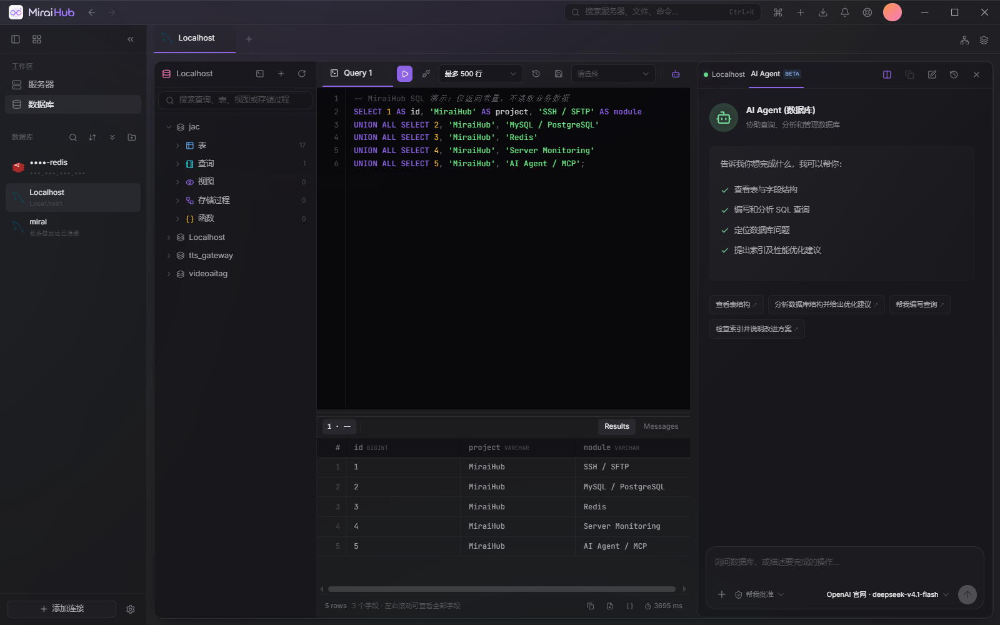

<div align="center">
  
  <h1>MiraiHub</h1>
  <p><strong>一站式服务器与开发基础设施工作台</strong></p>
  <p>SSH 终端 · 远端文件 · 数据库 · 服务器监控 · AI Agent</p>
  <p>
    <a href="https://github.com/XiangZi7/MiraiHub/releases">
      
    </a>
    <a href="https://github.com/XiangZi7/MiraiHub/releases">
      
    </a>
    <a href="https://github.com/XiangZi7/MiraiHub/actions/workflows/release.yml">
      
    </a>
    
    
    
    <a href="https://hub.xerj.org/contributors/XiangZi7">
      
    </a>
  </p>
  <p>
    <a href="https://github.com/XiangZi7/MiraiHub/releases/latest"><strong>下载最新版</strong></a> ·
    <a href="#快速上手">快速上手</a> ·
    <a href="#文档">文档</a> ·
    <a href="https://github.com/XiangZi7/MiraiHub/issues">反馈问题</a> ·
    <a href="README.en.md">English</a>
  </p>
</div>

<br />



MiraiHub 是一款基于 **Tauri 2 + Rust + Vue 3** 的桌面工作台。它把服务器连接、文件传输、数据库操作、监控和 AI 辅助放进同一个多标签窗口，面向开发者与服务器维护者。

适合在开发、测试和服务器维护中集中管理多个环境：用 SSH 检查服务，用文件面板传输与编辑配置，用数据库工作台查询数据，再让 AI Agent 在当前连接的上下文中辅助分析。

> 顶部图片为 AI 生成的产品宣传图；下方「界面预览」使用实际运行的 Windows 桌面应用截图。功能与入口以当前版本为准。

## 功能亮点

| | 功能 | 说明 |
| :-: | --- | --- |
| 🖥️ | **SSH 与本地终端** | 密码 / 私钥 / ssh-agent 认证、键盘交互与二次验证、主机指纹确认、多级跳板机；本地支持 PowerShell、CMD 与 Git Bash |
| ⏺️ | **终端效率工具** | 命令搜索与补全、带变量的命令片段、启动预设、SSH 输出录制与 asciicast v2 回放、意外断线自动重连 |
| 📁 | **双栏文件管理** | 本地 / 远端并排浏览、拖拽与批量传输、目录差异预览及单向同步、权限修改与递归删除；远端文本编辑支持保存冲突处理 |
| 🗄️ | **多引擎数据库** | MySQL、MariaDB、TiDB、PostgreSQL、SQLite：对象树、数据编辑、表结构设计、SQL 查询与导入导出；PostgreSQL 支持 schema 切换 |
| 🧩 | **数据库设计与运维** | ER 图、结构对比与迁移 SQL、CHECK / 触发器设计、执行计划、备份恢复、会话监控、用户与权限管理，按引擎提供对应能力 |
| ✨ | **SQL 与数据 AI 助手** | 自然语言生成 / 改写 SQL、报错修复、解释与优化、可选内联补全、结果集问答与图表、测试数据规则生成、Markdown / HTML 数据字典 |
| 🔑 | **Redis 工作台** | SCAN 与冒号分组、六类键的新建及编辑、重命名、TTL、按模式预览后批量删除、命令补全与历史 |
| 📈 | **服务器监控** | 通过 SSH 采集 CPU、内存、磁盘、网络与运行时间，展示资源阈值告警并可交给 AI 分析，无需在服务器安装 Agent |
| 🤖 | **AI Agent** | SSH、数据库与 Redis 内对话，支持提示词模板、图片与文件附件、加密历史、执行时间线、上下文压缩和 Token 用量；大文本附件可按需检索与分段读取 |
| 🔌 | **MCP 扩展** | 连接本地 stdio 或远程 Streamable HTTP 服务器，按连接类型提供外部工具，并显示调用参数供审批 |
| 🛠️ | **连接与运维** | 本地 / 远程 / 动态 SOCKS5 隧道、数据库经 SSH 连接、OpenSSH 配置导入、公钥部署、批量命令、连接分组与标签、加密连接备份 |
| 🪟 | **多标签分屏** | 拖动连接标签到工作区边缘创建分屏，独立切换各面板的连接，保留会话与编辑状态 |
| 🎨 | **个性化** | 中 / 英文并跟随系统、浅色 / 深色 / 跟随系统外观、主题皮肤、自定义配色与背景、界面缩放 |

## 近期新增与特色工作流

- **连接更多数据库**：新增 SQLite 文件连接，以及走 MySQL 协议的 MariaDB / TiDB 选项；远程数据库可复用已保存的 SSH 连接建立隧道。开发 / 测试 / 生产环境标识与只读连接便于区分目标，生产环境的危险操作要求输入库名确认。
- **从 SQL 编写到排错**：用自然语言生成或改写 SQL，比较 AI 提议后应用；查询失败可发起修复，配合执行计划检查优化建议。SQL 片段支持占位跳转，参数化查询支持 `:name`、`?`、`$1`，查询标签保留近期结果并可固定。
- **把数据库结构变成可交付成果**：用 ER 图查看外键关系，对比源库与目标库并复制迁移 SQL；生成 Markdown / HTML 数据字典，或让 AI 生成测试数据规则，在本地预览后再写入。
- **集中处理数据库运维**：调用 `mysqldump` / `pg_dump` 备份、`mysql` / `psql` 恢复，缺少工具时可回退内置 SQL 导入导出；SQLite 可备份为数据库文件。MySQL / PostgreSQL 另提供会话监控和用户权限管理。
- **从连接到文件同步**：导入 `~/.ssh/config`，配置跳板链并确认主机指纹；在本地 / 远端双栏中预览目录差异，只同步选中的新增或变化文件。终端支持命令变量填充、内联 AI 建议及录制回放。
- **直接编辑 Redis 集合**：在详情中管理 Hash、List、Set、Sorted Set、Stream，支持新建键、重命名和 TTL；批量删除先扫描预览再确认，命令面板提供补全与历史。
- **按任务组织工作区**：多个连接以标签形式打开，拖到边缘即可并排查看；SSH 内还可打开终端、远端文件、监控和 AI 面板。桌面端重复启动会聚焦已有实例。
- **查询后直接交付数据**：表格与查询结果支持导出为 SQL、Excel、CSV、JSON、TXT 或 HTML 数据字典；表数据可选择当前页或当前筛选范围，导出进度与取消入口统一放在传输中心。
- **让 AI 上下文更可控**：每条消息最多添加 16 个附件，其中图片最多 4 张；文本 / Office 附件加密保存在本机，模型通过预览、搜索和分段读取获取相关内容。每份模型配置独立设置请求次数、Token 窗口与输出上限，标准 / 增强 / 深度预设提供 4 / 16 / 64 MB 本地文本上下文容量。
- **在应用内更新**：在「设置 → 关于」检查更新，查看新版本后下载并安装；也可继续从 Releases 手动下载。

以上汇总自上次首页文档更新以来的功能，核对版本为 **v4.0.0（2026-11-09）**，不代表所有功能都首次加入 v4.0.0。发布包功能以对应 Release 为准；各数据库能力与限制见 [数据库工作台](docs/database.md)。本地消息容量与模型的 Token 窗口分别设置，调大本地容量不会扩大模型窗口。

## 界面预览

**当前工作区与命令面板**：在 Windows 桌面开发版中打开本地终端，通过命令面板访问连接、文件、SQL 和搜索入口。终端仅启动 Shell，未执行演示命令；本地目录已遮盖。



<table>
  <tr>
    <td width="50%" align="center">
      <a href="docs/images/ssh-connection.png"></a><br />
      <sub><b>SSH 连接、认证与标签配置</b></sub>
    </td>
    <td width="50%" align="center">
      <a href="docs/images/redis-connection.png"></a><br />
      <sub><b>Redis 连接与逻辑数据库选择</b></sub>
    </td>
  </tr>
  <tr>
    <td width="50%" align="center">
      <a href="docs/images/ai-agent.png"></a><br />
      <sub><b>AI 模型配置与 API 协议选择</b></sub>
    </td>
    <td width="50%" align="center">
      <a href="docs/images/ai-capacity.png"></a><br />
      <sub><b>任务容量、Token 预算与自动重试</b></sub>
    </td>
  </tr>
  <tr>
    <td colspan="2" align="center">
      <a href="docs/images/skin.png"></a><br />
      <sub><b>主题皮肤、背景与实时预览</b></sub>
    </td>
  </tr>
</table>

上方六张截图于 **2026-10-30** 采集自 **v3.0.9 Windows 桌面开发版**，使用当天已有的前端构建与真实 Tauri WebView2。SSH、Redis 和 AI 配置均为未保存的示例，未发送模型请求；主题中的数据库窗口是内置预览。真实服务地址、私钥路径和本地目录均未出现在图片中，点击图片可查看原图。

<details>
<summary><b>查看数据库、SSH 文件与服务器监控的历史实机截图</b></summary>

以下保留较早版本的已连接实机截图，用于展示数据库、SSH 文件与监控布局。本次未使用已认证的 SSH / 数据库连接，未更新这三张图，界面入口可能与当前版本不同。

**v2.0.25 数据库工作台与 AI 分屏**：本机 MySQL 实际连接，SQL 仅返回示例常量。




</details>

## 下载与安装

前往 [Releases](https://github.com/XiangZi7/MiraiHub/releases/latest) 下载。当前仅提供 **Windows x64** 构建，macOS / Linux 暂未发布。

已安装用户也可通过「设置 → 关于」检查应用更新。

| 文件 | 说明 |
| --- | --- |
| `MiraiHub_<version>_windows_x64_setup.exe` | 安装版，按向导完成安装 |
| `MiraiHub_<version>_windows_x64_portable.zip` | 免安装版，解压后运行 `miraihub.exe`，需已安装 [WebView2 Runtime](https://developer.microsoft.com/microsoft-edge/webview2/) |
| `SHA256SUMS.txt` / `version.json` | 校验值与版本、源码提交信息 |

> 安装包暂未做代码签名，Windows SmartScreen 可能提示“未知发布者”，选择「仍要运行」即可。用户数据保存在系统应用数据目录，不随免安装包移动。

## 快速上手

1. **添加连接**：在侧栏新建 SSH、本地终端或数据库连接；SSH 可从 `~/.ssh/config` 导入，SQLite 选择本地数据库文件，其他连接填写地址、端口与认证信息。可用分组和标签整理。
2. **进入工作区**：SSH 连接后可使用终端、文件面板与服务器概览；数据库连接后可浏览对象、编辑数据或执行 SQL。
3. **配置 AI（可选）**：「设置 → AI Agent」中添加服务地址、API 格式、模型 ID 和 API Key，保存后测试连接。
4. **与 AI 协作**：在工作区打开 AI Agent 标签或分屏，在输入区选择「请求批准 / 帮我批准 / 完全访问权限」。AI 提议执行命令或 SQL 时，按所选模式核对并处理审批。

AI 功能需要自备支持工具调用的模型服务，内置 OpenAI、Claude、DeepSeek、豆包、Gemini 与自定义模板。支持 **OpenAI Chat Completions 兼容格式**、**OpenAI Responses** 和 **Claude Messages**；请根据服务商的接口选择对应协议。Gemini 模板使用 OpenAI 兼容入口。详见 [AI Agent 文档](docs/ai-agent.md)。

### 常用快捷键

| 操作 | 默认快捷键 |
| --- | --- |
| 命令面板（SQL 编辑器外） | `Ctrl+K` |
| 新建本地终端 | `Ctrl+T` |
| 搜索入口 | `Ctrl+Shift+F` |
| 远端文件面板 | `Ctrl+O` |
| 搜索终端内容 | `Ctrl+F` |
| 执行 SQL / Redis 命令 | `Ctrl+Enter` |
| 执行光标所在 SQL 语句 | `Ctrl+Shift+Enter` |
| SQL AI 生成 / 改写（编辑器内） | `Ctrl+K` |
| 查看 SQL 执行计划（编辑器内） | `Ctrl+E` |
| 格式化 SQL | `Shift+Alt+F` |
| SSH 内联 AI 命令建议（AI 可用时） | `Ctrl+I` |
| 全屏 / 退出全屏 | `F11` / `Esc` |

全局快捷键可在「设置 → 快捷键」中调整，终端和查询快捷键在对应工作区生效。

## 支持范围

| 模块 | 当前支持 | 边界 |
| --- | --- | --- |
| 桌面平台 | Windows x64 | 当前发布流程仅构建 Windows；macOS / Linux 暂未发布 |
| SSH | 密码、私钥、ssh-agent、键盘交互、多级跳板、代理、三类隧道 | 跳板最多 5 级且不能与目标代理同时使用；本地 / 动态监听及远程监听均限制在回环地址，动态 SOCKS5 仅支持无认证 CONNECT |
| 关系型数据库 | MySQL、MariaDB / TiDB（MySQL 协议）、PostgreSQL、SQLite | 设计器与运维能力按引擎区分；SQLite 是本地文件，无服务端会话 / 用户管理，不支持修改或删除库，部分结构迁移需手动处理 |
| Redis | 单节点、逻辑 DB 切换、六类键编辑、批量删除、命令面板 | 暂不提供 Cluster 路由与 Sentinel 发现；保留 TTL 的 String 编辑需要 Redis 6.0+，集合编辑需要相关命令及 EVAL 权限 |
| 服务器监控 | 通过 SSH 读取系统与资源指标 | 需要服务器允许相关系统命令；不需要另装监控 Agent |
| AI Agent | 三种 API 格式、工具调用、MCP 扩展 | 需自行配置模型服务；模型应支持所选协议及工具调用 |

## 隐私与安全

- **模型请求**：对话、附件预览 / 读取片段和工具结果发送到自己配置的模型服务。SSH Agent 可通过 `read_terminal` 读取已连接会话的近期输出，默认当前会话；内联命令建议会发送最近终端上下文，SQL AI 会按功能发送 SQL、结构、报错或结果样本。不会自动读取 SSH 密码或私钥文件。
- **本地存储**：Windows 上 AI 配置与聊天历史使用当前用户的 DPAPI 加密；连接配置及选择保存的密码、私钥口令存放在本地 WebView 存储中。
- **连接备份**：默认不导出凭据；如需包含，必须设置独立的备份密码。
- **操作审批**：AI 操作按所选权限模式执行；逐次审批与自动只读模式下，外部 MCP 工具都需要单独确认。停止任务不会回滚已经执行的操作。

## 常见问题

<details>
<summary><b>免安装版打不开，或出现 WebView2 相关错误？</b></summary>

先完整解压 ZIP，再运行 `miraihub.exe`，并保留随包提供的资源文件夹。确认系统已安装 WebView2 Runtime；安装版会按打包配置安装缺失的运行时。

</details>

<details>
<summary><b>只启动 <code>pnpm dev</code>，为什么 SSH、数据库或 AI 无法使用？</b></summary>

`pnpm dev` 启动浏览器前端，原生功能由 Rust 后端提供。请使用 `pnpm tauri dev` 启动完整桌面应用。

</details>

<details>
<summary><b>模型服务可以在其他客户端使用，这里却报协议错误？</b></summary>

核对基础地址、模型 ID、API Key 和 API 格式。使用 `/responses` 的服务应选择「OpenAI · Responses」，Claude 原生接口选择 Messages。服务还需支持工具调用，程序不会自动切换协议。完整说明见 [AI Agent](docs/ai-agent.md)。

</details>

<details>
<summary><b>换电脑时如何迁移连接？</b></summary>

在「设置 → 备份与恢复」导出，在新电脑读取并预览恢复计划。包含凭据时设置独立备份密码；私钥文件、AI 配置和聊天历史不在连接备份内，需分别处理。详细步骤见 [SSH 运维](docs/ssh-operations.md#连接备份)。

</details>

## 本地开发

| 依赖 | 版本 |
| --- | --- |
| Node.js | 22.22.2 |
| pnpm | 10.33.0（由 `packageManager` 字段锁定） |
| Rust | 1.96.0 |
| Windows | Visual Studio C++ Build Tools、Windows SDK、WebView2 Runtime |

```powershell
git clone https://github.com/XiangZi7/MiraiHub.git
cd MiraiHub
pnpm install --frozen-lockfile
pnpm tauri dev          # 启动前端与桌面应用
```

```powershell
pnpm test                                                        # 前端与发布逻辑测试
cargo test --locked --manifest-path src-tauri/Cargo.toml --lib   # Rust 后端测试
pnpm build                                                       # 类型检查与前端构建
pnpm release:build                                               # 构建 Windows 安装包
pnpm release [patch|minor|major] [--dry-run]                     # 发版：同步版本、打标签并推送
```

仅运行 `pnpm dev` 可预览前端界面，SSH、数据库等原生能力需在 Tauri 应用中使用。发版细节见 [发版说明](docs/RELEASING.md)。

## 文档

| 文档 | 内容 |
| --- | --- |
| [数据库工作台](docs/database.md) | 引擎支持、数据编辑、SQL / AI、设计器、ER 图、结构对比、备份与运维 |
| [AI Agent](docs/ai-agent.md) | 模型配置、提示词模板、附件检索、SQL / 终端辅助、审批与数据处理 |
| [Redis 工作台](docs/redis.md) | 六类键编辑、TTL、批量删除、命令历史、AI 工具与监控接入状态 |
| [SSH 运维](docs/ssh-operations.md) | 跳板与认证、三类隧道、文件同步、终端录制、批量命令与连接备份 |
| [主题皮肤](docs/theme-skins.md) | 主题、自定义背景、配色与分屏布局 |
| [界面语言](docs/languages.md) | 中英文切换与跟随系统语言 |
| [前端架构](docs/FRONTEND_ARCHITECTURE.md) | 目录职责、路由、会话缓存与 Store 约定 |
| [性能说明](docs/PERFORMANCE.md) | 性能相关实现与验证记录 |
| [发版说明](docs/RELEASING.md) | 自动发布、版本管理与本地打包 |
| [截图维护](docs/images/README.md) | README 图片的命名与替换方式 |

## 参与贡献

欢迎通过 [Issues](https://github.com/XiangZi7/MiraiHub/issues) 反馈问题或提出需求，也欢迎提交 Pull Request。

- **反馈问题**：附上应用版本、系统版本、复现步骤与预期结果；截图和日志请先去除密码、私钥、API Key。
- **提交改动**：每个 PR 聚焦一个问题，说明改动与验证方式；功能变化请同步更新文档与中英文翻译。

## 许可证

本项目采用 [MIT 许可证](LICENSE)，Copyright (c) 2026 XiangZi。

允许商业使用、修改、分发及闭源使用，但须保留版权声明和许可声明。软件按“原样”提供，不附带任何担保，完整条款见 [LICENSE](LICENSE)。第三方依赖及资源仍遵循各自的许可证。

<div align="center">
  <sub>Made with ❤️ by <a href="https://github.com/XiangZi7">XiangZi</a></sub>
</div>
