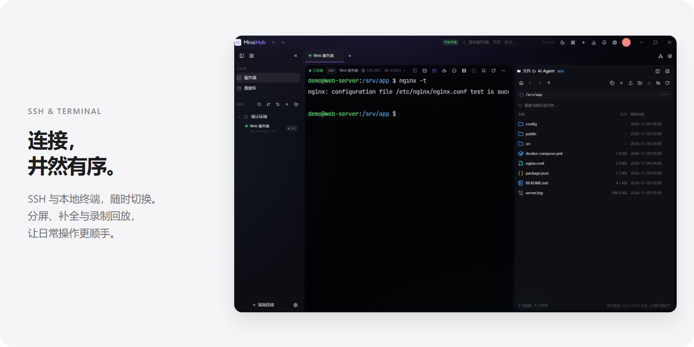
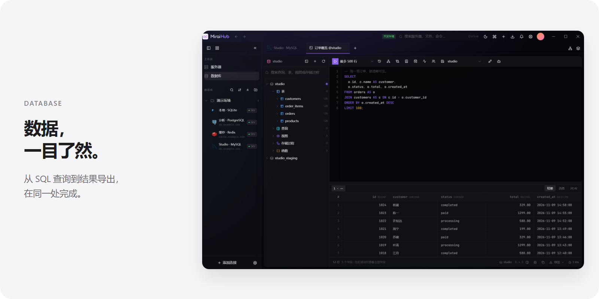
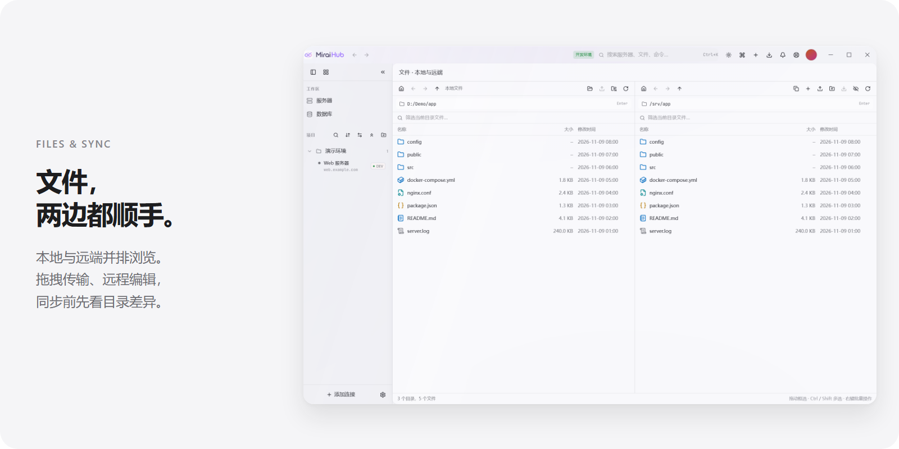
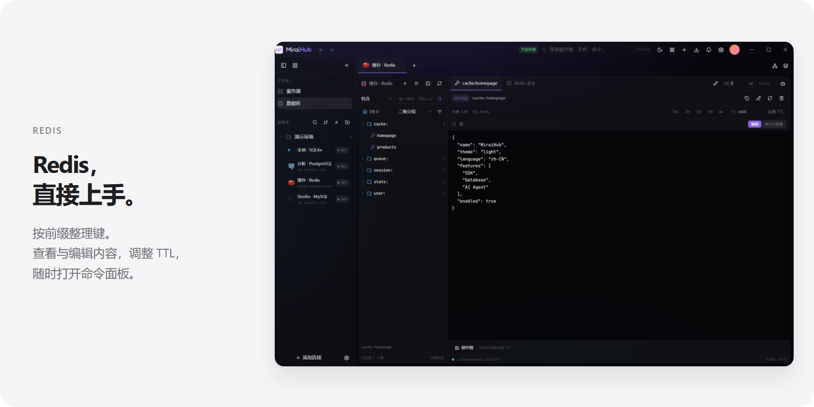
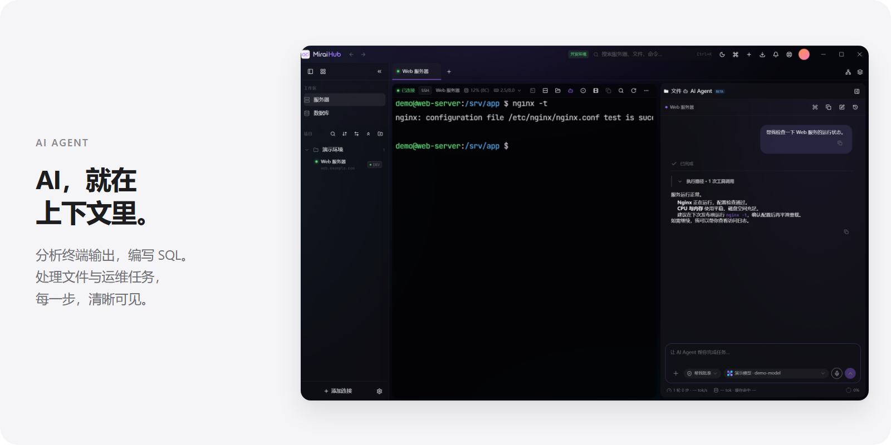
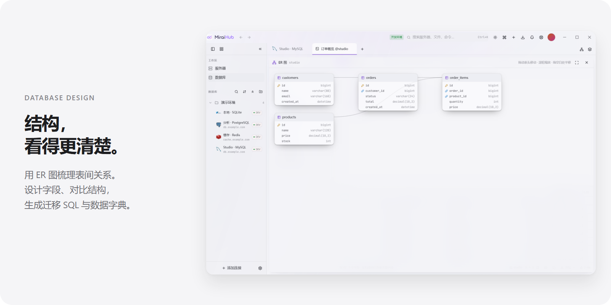
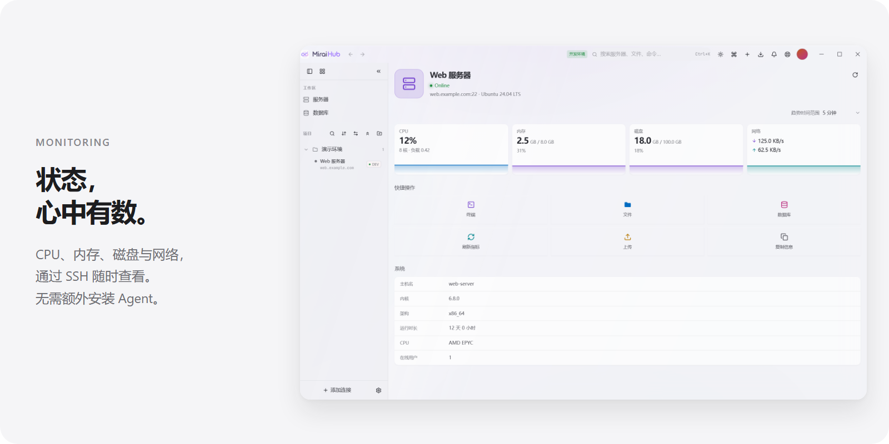
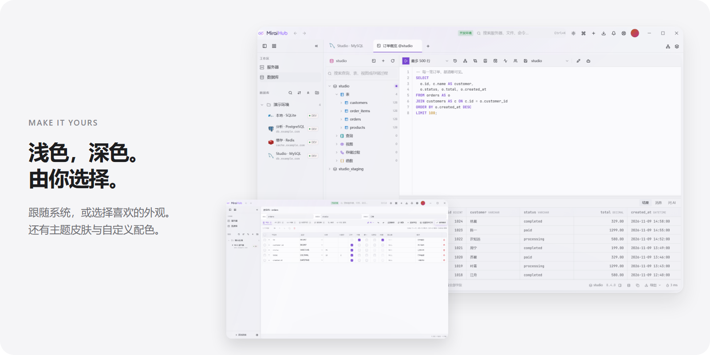

<a href="https://github.com/XiangZi7/MiraiHub/releases/latest"></a>

<p align="center"><a href="https://github.com/XiangZi7/MiraiHub/releases/latest"><strong>下载桌面版 →</strong></a>　·　<a href="#快速开始">快速开始</a>　·　<a href="#文档">文档</a>　·　<a href="README.en.md">English</a></p>

<p align="center"><sub>Windows · macOS · Linux　/　<a href="LICENSE">MIT 开源</a></sub></p>

<br />

## 界面预览

<a href="docs/images/feature-ssh-dark.png"></a>

<a href="docs/images/feature-database-dark.png"></a>

<sub>MySQL · MariaDB · TiDB · PostgreSQL · SQLite</sub>

<a href="docs/images/feature-files-light.png"></a>

<a href="docs/images/feature-redis-dark.png"></a>

<a href="docs/images/feature-ai-dark.png"></a>

<a href="docs/images/feature-er-light.png"></a>

<a href="docs/images/feature-monitor-light.png"></a>

<a href="docs/images/feature-database-light.png"></a>

<sub>当前组件与独立演示数据；产品图由 AI 生成。点击卡片可看原始截图。[素材说明与表结构原图](docs/images/README.md)</sub>

<br />

## 下载与安装

自动构建目标为 Windows x64、macOS Intel / Apple Silicon、Linux x64。下表使用最新正式版的固定文件名；新平台与链接从包含本次改动的新 Release 起提供，旧版本请查看 [实际附件](https://github.com/XiangZi7/MiraiHub/releases/latest)。

| 架构 | Windows | macOS | Linux / Ubuntu |
| --- | --- | --- | --- |
| x86-64（64 位） | [EXE](https://github.com/XiangZi7/MiraiHub/releases/latest/download/MiraiHub_windows_x64_setup.exe) · [ZIP](https://github.com/XiangZi7/MiraiHub/releases/latest/download/MiraiHub_windows_x64_portable.zip) | [DMG（Intel）](https://github.com/XiangZi7/MiraiHub/releases/latest/download/MiraiHub_macos_x64.dmg) | [DEB](https://github.com/XiangZi7/MiraiHub/releases/latest/download/MiraiHub_linux_x64.deb) · [AppImage](https://github.com/XiangZi7/MiraiHub/releases/latest/download/MiraiHub_linux_x64.AppImage) |
| AArch64（ARM64） | — | [DMG（Apple Silicon）](https://github.com/XiangZi7/MiraiHub/releases/latest/download/MiraiHub_macos_arm64.dmg) | — |

Windows ZIP 需 [WebView2 Runtime](https://developer.microsoft.com/microsoft-edge/webview2/)。macOS 11+ 请先将应用拖入「应用程序」；默认临时签名、未配置 Apple 公证，首次打开可能需要在「隐私与安全性」允许。Linux 面向 Ubuntu 22.04+ / 兼容 WebKitGTK 4.1 的发行版；AppImage 需执行权限。AI 安全存储在 Linux 需要已解锁的 Secret Service。

Windows 安装版、macOS 应用与 Linux AppImage 可在「设置 → 关于」更新；DEB 与 Windows ZIP 手动更新。[SHA256SUMS.txt](https://github.com/XiangZi7/MiraiHub/releases/latest/download/SHA256SUMS.txt) 用于校验，[version.json](https://github.com/XiangZi7/MiraiHub/releases/latest/download/version.json) 记录版本与源码提交。更多说明见 [发布文档](docs/RELEASING.md)。

## 快速开始

1. 按上方下载表选择系统与架构，下载安装包。
2. 添加 SSH、本地终端或数据库连接，进入工作区。
3. 需要 AI 时，在「设置 → AI Agent」填入自己的模型服务与 API Key。

免安装版需 [WebView2 Runtime](https://developer.microsoft.com/microsoft-edge/webview2/)。已安装用户可在「设置 → 关于」检查更新。

| 常用操作 | 快捷键 |
| --- | --- |
| 命令面板 | `Ctrl+K` |
| 新建本地终端 | `Ctrl+T` |
| 执行 SQL / Redis 命令 | `Ctrl+Enter` |
| SQL AI 生成 / 改写 | SQL 编辑器内 `Ctrl+K` |

## 文档

[数据库](docs/database.md) · [SSH 与文件](docs/ssh-operations.md) · [Redis](docs/redis.md) · [AI Agent](docs/ai-agent.md) · [主题](docs/theme-skins.md) · [语言](docs/languages.md)

<details>
<summary>本地开发</summary>

需要 Node.js 22、pnpm 10、Rust，以及对应系统依赖：Windows C++ Build Tools / WebView2、macOS Xcode Command Line Tools，或 Linux WebKitGTK 4.1 等（见 [发布文档](docs/RELEASING.md)）。

```powershell
pnpm install --frozen-lockfile
pnpm tauri dev
```

`pnpm build` 检查类型并构建前端；`pnpm test` 运行测试。仅运行 `pnpm dev` 可预览前端，原生能力需完整桌面应用。

[前端架构](docs/FRONTEND_ARCHITECTURE.md) · [性能说明](docs/PERFORMANCE.md) · [发版说明](docs/RELEASING.md)

</details>

<details>
<summary>数据与操作</summary>

AI 对话、附件片段和工具结果会发送到你配置的模型服务，操作按所选审批模式执行。连接备份默认不含凭据；详细数据处理与能力边界见 [AI Agent](docs/ai-agent.md)、[SSH 运维](docs/ssh-operations.md) 和 [数据库文档](docs/database.md)。

</details>

<br />

[反馈问题](https://github.com/XiangZi7/MiraiHub/issues) · [参与贡献](https://github.com/XiangZi7/MiraiHub/pulls) · [MIT License](LICENSE)

<sub>Made by <a href="https://github.com/XiangZi7">XiangZi</a></sub>
