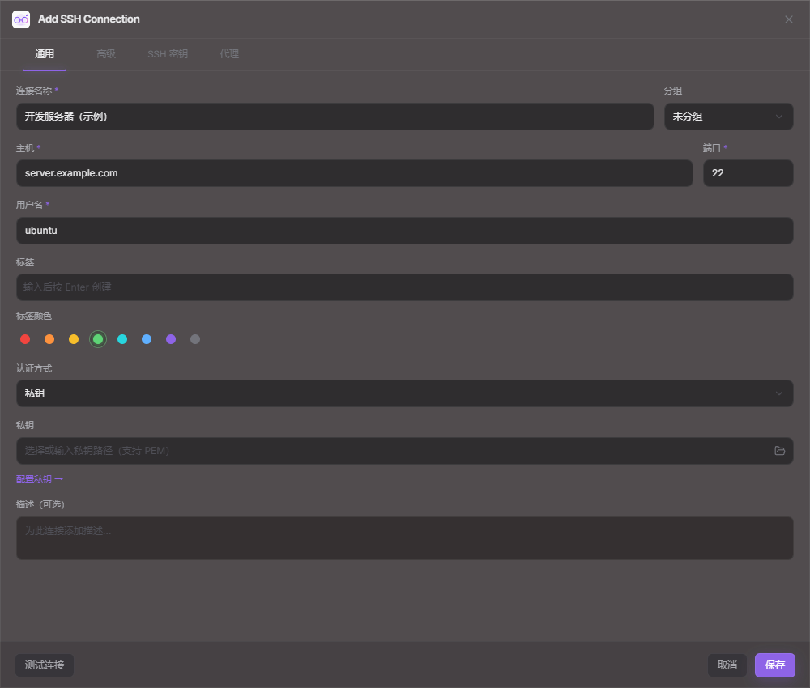
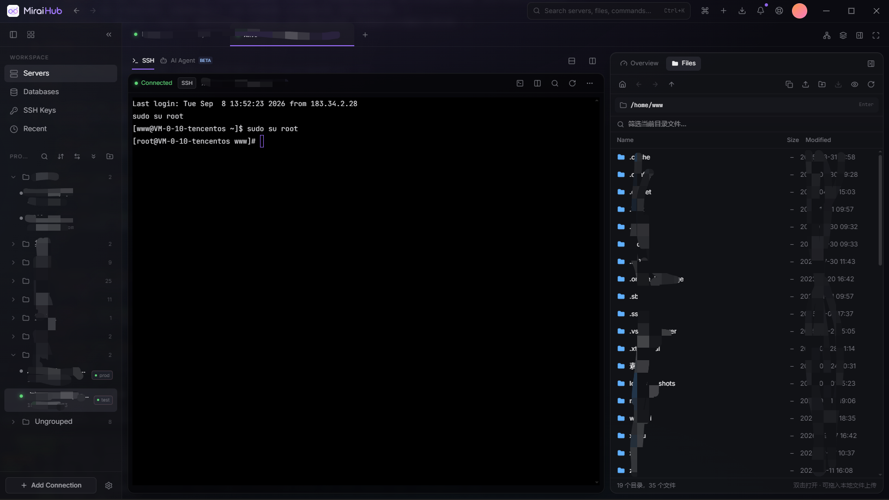
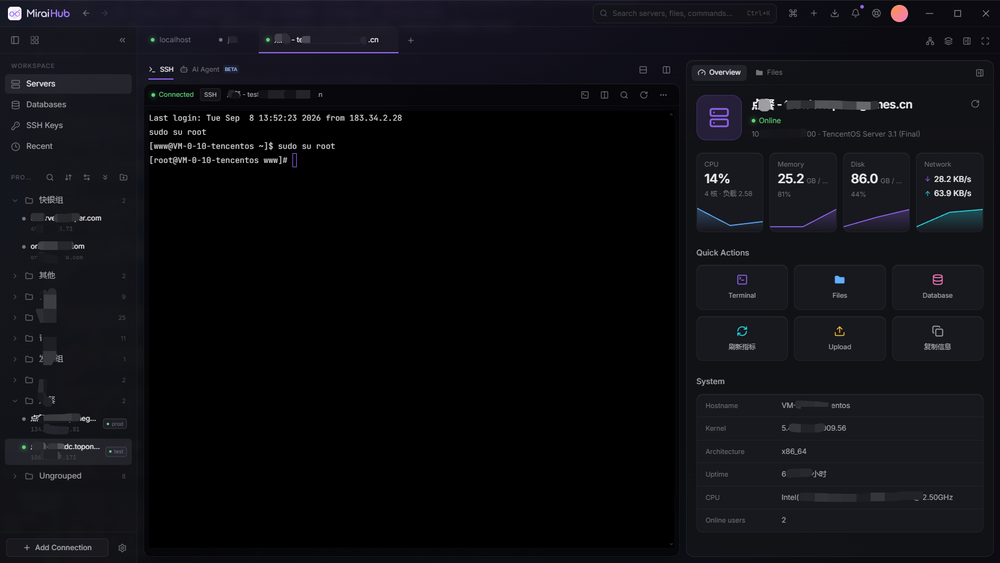

# SSH 运维功能

## 界面预览

连接配置截图采集自 v2.0.25 桌面开发版，`server.example.com` 为未保存的示例地址，私钥路径已隐藏。

SSH 文件与服务器监控的历史界面

以下保留仓库原有的较早版本实机截图。本次 SSH 连接未成功，未用模拟数据替代监控指标。

## 使用入口

- 顶部连接标签栏右侧的网络图标：SSH 隧道 / 端口转发。
- 旁边的多层图标：批量服务器操作。
- SSH 的 Files 面板：双击普通文件或右键选择“编辑文本文件”。右键仍可下载并用外部程序打开。
- 设置 → 备份与恢复：导出连接备份、读取预览、确认恢复。

## 终端复制与右键菜单

在 SSH 终端中拖动选中文字后，右键选择“复制选中内容”，或点击工具栏的复制按钮。右键菜单也提供粘贴、全选、清除回滚内容和断开连接；分屏中的菜单只操作所在终端。本地终端共用这组操作。

有选区时，`Ctrl+C` 或 `Ctrl+Shift+C` 复制内容；没有选区时，`Ctrl+C` 仍向终端发送中断信号。`Ctrl+Shift+V` 粘贴剪贴板文本，`Shift+F10` 打开菜单。按 `Esc` 关闭菜单后可继续输入命令。复制遵循设置中的自动清空剪贴板时间。

## 通过代理连接

连接配置的 Proxy 页可以让这条 SSH 连接经 SOCKS5 或 HTTP CONNECT 代理建立。典型用法是代理软件（Clash、v2rayN、sing-box 等）开着本地端口时，把代理地址填成 `127.0.0.1`、端口填代理软件的混合端口（常见 7890 / 10808），这样不用开 TUN 模式也能让指定连接走代理，直连的机器不受影响。

目标主机名以域名形式交给代理解析，代理软件的分流规则对它生效。用户名和密码可选，SOCKS5 走 RFC 1929 用户名/密码子协商，HTTP 走 `Proxy-Authorization: Basic`。代理握手与 SSH 握手共用同一个连接超时。代理相关的失败会在错误里带上代理地址，与目标机不通区分开。

代理密码与登录凭据一起受“导出时包含凭据”的开关控制；旧版备份中的 `proxy` 段会按同样规则导入，未识别的代理类型会被忽略并给出提示。

## 本地端口转发

通过已经认证的 SSH 会话使用 direct-tcpip 通道，不拼接 shell 命令。监听地址限制为回环地址，界面固定 127.0.0.1；本地端口 0 自动分配。目标地址由 SSH 服务器访问。每条隧道最多 32 个并发连接。

关闭管理窗口后隧道继续运行，断开对应 SSH 或退出程序后停止。可查看端口、活动连接数与错误，停止后可移除记录。隧道类型见下一节。

### 隧道类型

`ssh_tunnel_start` 请求新增 `kind` 字段（`local` / `remote` / `dynamic`，缺省为 `local`，旧数据与旧前端照常可用），列表项以 L / R / D 徽标显示摘要。

- 本地转发（`ssh -L`）：本机 `127.0.0.1:端口` → SSH 服务器 → 目标，见上文。
- 远程转发（`ssh -R`）：通过 `tcpip-forward` 请求在 SSH 服务器上监听，监听地址仅允许 `127.0.0.1` / `localhost` / `::1`，端口 0 由服务器分配。服务器回连的 forwarded-tcpip 通道按（地址，端口）路由到对应隧道，由本机连接目标并双向转发；停止隧道时发送 `cancel-tcpip-forward`。
- 动态转发（`ssh -D`）：本机 `127.0.0.1:端口` 运行 SOCKS5 服务（`ssh/socks5.rs`，仅无认证 + CONNECT，支持 IPv4 / IPv6 / 域名），每个连接经 direct-tcpip 通道访问请求的目标；目标不可达时返回对应 SOCKS5 错误码。

## 文件上传与下载

“同时传输的任务数”限制顶层文件或文件夹任务；“文件夹上传并发数”限制每个文件夹内同时上传的文件数，默认仍为 12。两项设置会叠加，不能把文件并发数直接当作 SSH 通道数。

同一 SSH 连接的所有上传、下载共享最多 4 条传输通道，文件检查和编辑另外预留最多 2 条通道。必要通道额度不足时等待，排队期间可以取消；文件夹加开的通道只使用空闲额度，不会等待其他任务释放。每条上传通道最多同时处理 3 个文件，实际并发受用户设置和已获得的通道数共同限制。后台读写任务结束后才归还通道额度，避免短时间内反复开关通道冲击服务器会话上限。

遇到服务器临时拒绝新通道时，必要通道会短暂退避重试；文件检查请求超时为 30 秒，上传和下载使用 120 秒请求超时，以容忍传输期间的链路拥塞。

## 远端文本编辑

编辑器绑定打开时的 SSH 会话和规范化绝对路径，不随当前标签改变目标。支持不超过 1 MB 的 UTF-8 普通文件，保留 BOM、LF / CRLF。二进制、混合换行、符号链接拒绝编辑。

窗口提供一个文本域和保存按钮，也支持 Ctrl+S。打开时记录远端大小与修改时间（SFTP 精度为秒），保存前重新 stat；若远端已变化返回 `conflict` 错误，编辑器提示“远端文件已被修改”，可选覆盖保存（`ssh_text_save` 传 `force: true`）、重新加载或取消。不做差异预览。

保存先写同目录临时文件 `.<name>.miraihub.tmp` 并沿用原权限位，再 rename 覆盖原文件；服务器拒绝覆盖式 rename 时先把原文件改名为 `.<name>.miraihub.bak`，替换失败再还原。属主/属组与当前用户不一致、无法创建临时文件或替换失败时，回退为直接截断写入，此时连接中断仍可能留下部分内容。临时文件先删除残留再以 O_EXCL 独占创建，不会跟随预置的同名软链；保存在独立任务中执行，45 秒超时只停止等待，不会中断备份/落位这一步。

关闭未保存的文件时会提示。文件列表中，复制路径旁的加号菜单可新建空文件或文件夹。

## 文件权限与递归删除

文件右键“修改权限”（`ssh_chmod_path`）提供 rwx 九宫格与八进制输入双向同步，支持 setuid/setgid/sticky；目录可选“递归应用到子项”，不跟随符号链接，返回修改的项目数。递归修改中途失败时已修改的项不会回滚。

删除目录使用 `ssh_delete_tree`：深度优先先删文件再删目录，不跟随符号链接，遇到第一个错误即停止并报告失败路径与已删除数量。选中项包含目录时，即使关闭了删除确认也会弹出递归删除提示。递归操作拒绝根目录、相对路径和含 `..` 的路径。

SFTP 不可用时的 `ls -lA` 回退解析保留文件名首尾空格，仅对符号链接拆分 ` -> `，并兼容设备文件的“主, 次”设备号列。文件区拖拽上传使用 dragenter/dragleave 计数，避免经过子元素时提示层闪烁。

## 批量命令

最多选择 20 个已连接 SSH 会话，生成包含完整命令和固定目标的计划。每次计划有效期 5 分钟，审批只能消费一次，执行时不接受改写后的命令或目标。前端确认默认未勾选。

最多同时执行 3 台服务器，每台独立命令通道、30 秒期限、约 16 KB 输出上限。分别展示标准输出、错误输出及退出码，一台失败不阻止其他目标。停止只取消尚未开始的任务；已经产生的修改不回滚，关闭通道也不保证终止远端派生进程。记录保留在本次窗口内，可复制。

## 连接备份

包含 SSH、本地终端、MySQL / PostgreSQL、Redis 连接及分组、标签，不包含 AI 配置、私钥文件、查询历史。默认剔除密码、私钥口令和启动命令，后端对未加密备份再做一次清理。

包含凭据必须设置独立备份密码。密码经 Argon2id 派生密钥，使用 AES-256-GCM 和随机 salt / nonce 加密认证。未加密或加密数据均写入同目录临时文件，完整写入并同步后替换指定备份文件。备份不依赖当前电脑的 DPAPI，可跨电脑恢复；密钥路径与证书路径仍需在新电脑核对。

恢复先校验版本、数量、字段和端口，再展示新增 / 更新 / 跳过计划。默认跳过同 ID 连接，可选择更新或全部作为新连接导入。凭据和启动命令分别默认不恢复；关闭“记住密码”时不能恢复凭据。改变目标地址或用户名时，不沿用旧目标的密码。启用恢复启动命令时展示原命令供核对。

确认前再次检查本地配置是否变化；存储写入失败会尝试恢复原值。恢复不自动连接或执行启动命令。恢复后的配置遵循现有本地连接存储策略；备份加密不改变连接配置自身的存储方式。

## 从 ~/.ssh/config 导入

侧栏“新建连接”菜单里的“从 ~/.ssh/config 导入”调用 `ssh_config_preview`（仅主窗口），由 `ssh/openssh_config.rs` 解析 Host、HostName、User、Port、IdentityFile（展开 `~`）与 ProxyJump，按 OpenSSH 首个匹配生效的规则合并通配 Host 的默认值。通配 Host 本身和 Match 块不导入；Include 相对 `~/.ssh` 解析并支持文件名通配，限制嵌套深度并检测循环。ProxyJump 展开为跳板链：全部能对上已保存连接时写入 `jumpHostIds`，否则以 `ProxyJump user@host:port,...` 写入备注。

预览按地址、端口、用户名标注已存在的连接，默认不勾选；导入复用前端连接存储，不会自动连接。

## 部署公钥到服务器（ssh-copy-id）

密钥管理详情页的“部署到服务器”先连接所选的已保存 SSH 连接，再调用 `ssh_deploy_public_key(sessionId, keyId)`，结束后断开。后端只接受 `~/.ssh` 内的密钥，读取并校验 `.pub` 为单行合法公钥，通过 `sh -c` 执行：`mkdir -p ~/.ssh && chmod 700`，按公钥 base64 去重，缺少末尾换行时补齐，用 `printf '%s\n'` 追加并 `chmod 600`。公钥内容经单引号转义，结果为 `added` 或 `exists`。

## 终端输出合并、历史与内联 AI

`ssh/output.rs` 合并交互式 shell 的输出：同一批数据在 8ms 内或攒满 32KB 时经 Channel 推送一次，保持顺序，通道关闭前把剩余数据全部推送。同时每个会话保留约 2000 行去掉 ANSI 序列的纯文本历史，会近似处理 `\r`、退格和光标左右移动，并跳过备用屏幕（vim/top）的内容。Agent 内置工具 `read_terminal(session_id?, lines=80, ≤500)` 从这份历史读取，`session_id` 缺省时取当前会话，属于低风险只读操作。

`ai_shell_command(sessionId, request, context, language)` 把自然语言转换成一条命令建议 `{command, explanation, risk}`，只返回建议、不执行。远端系统信息（uname、os-release、shell）按会话探测一次后缓存；`context` 为空时用后端终端历史的最近 40 行。模型被要求只输出 JSON，解析失败时退回到代码块或单行文本。风险取模型判断与后端规则的较高者：含 rm/dd 等危险命令一律为 high，非只读命令至少为 medium。相同请求的结果缓存 120 秒。

`ssh_exec` 支持可选参数 `timeoutSecs`，缺省 30 秒，最长 3600 秒；超时后关闭通道并报错。时限从打开通道算起，后端内部的 `exec`（文件、补全、监控探测等）同样受 30 秒默认时限约束；超时错误类型为 network，只关闭本地通道，远端进程可能仍在运行。

## 验证范围

执行 `node --test tests/*.test.mjs`、`cargo test --offline --manifest-path src-tauri/Cargo.toml --lib` 和前端生产构建。测试涵盖加密往返、错误密码与篡改、备份替换失败、恢复凭据隔离、一次性/过期审批、回环监听限制、文本格式与元数据冲突等。

使用隔离的模拟 IPC 页面验证编辑预览/确认/冲突/放弃草稿、隧道启停、批量审批与独立结果、恢复预览和 150% 缩放下的布局。尚未使用真实 SSH 服务器联调这些新增操作。
